

  
  <h1>Pokémon Desktop Companion</h1>
  

    A desktop tamagotchi: in a small window that always floats on top of your screen, 
    a Pokémon travels, battles, farms items and grows up on its own.
  

  

    
    
    
  

  

    
    
    
  

  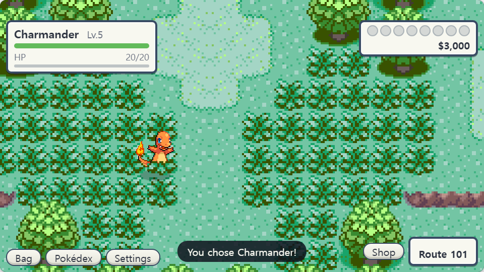

> [!NOTE]
> **This is a non-commercial fan project.** All rights to Pokémon and its related names, images and music
> belong to Nintendo / Creatures Inc. / GAME FREAK inc.

## Download

Grab the file for your OS from the [latest release](https://github.com/jaw753951-spec/pokemon-destop-companion/releases/latest).

| OS | File |
| --- | --- |
| Windows | `*-win-x64.zip` — unzip it and run `Pokemon Desktop Companion.exe` |
| macOS | Apple silicon (M1 and later) `*-mac-arm64.dmg` · Intel `*-mac-x64.dmg` |
| Linux | `*-linux-x86_64.AppImage` |

### The first launch

This is a personal fan project with no signing certificate, so your OS will block it once. You only have to get
past it the one time.

- **Windows** — there is no installer; just unzip it. If a "Windows protected your PC" window appears, choose
  **More info → Run anyway**.
- **macOS** — **right-click the app → Open → Open**. If it is still blocked, run this in Terminal:
  `xattr -dr com.apple.quarantine "/Applications/Pokemon Desktop Companion.app"`
- **Linux** — `chmod +x *.AppImage`, then run it.

### Good to know

- The window is small and always stays on top. Hover over the top of the window and a drag
  bar appears; its position and size are remembered.
- The three save slots and your settings are stored outside the app (`userData`), so they survive an update.

## Auto save

Progress is **saved automatically every 5 minutes**. You can also save and leave yourself with **Save and return
to title** / **Save and quit** in the settings.

## Controls

- The window **always floats above other windows**. Drag it by the top edge or anywhere outside the game picture
  to move it, and the spot is remembered.
- **Press and hold on the screen to fast-forward.** Let go and it returns to normal speed.
- During a battle, pressing the screen skips through the messages faster.
- The buttons along the bottom open the **Bag · Pokédex · Settings · Shop**. Your Pokémon keeps walking while a
  menu is open.

## The journey

Your Pokémon walks the real maps of **Hoenn** (Emerald) and **Kanto** (FireRed). Along the way it comes across
berry trees, item balls, wild Pokémon and trainers, and every so often it moves on to a new place. When it runs
low on health, potions or balls, a Pokémon Center turns up.

<table>
  <tr>
    <td width="50%" align="center">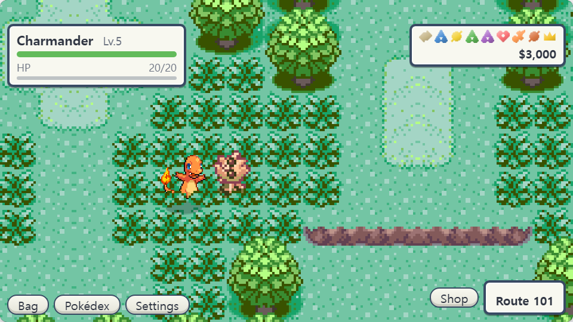 A berry tree</td>
    <td width="50%" align="center">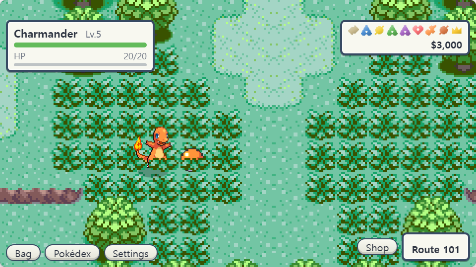 An item ball</td>
  </tr>
  <tr>
    <td width="50%" align="center">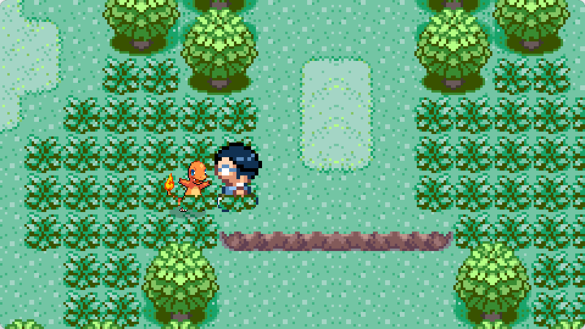 A trainer</td>
    <td width="50%" align="center">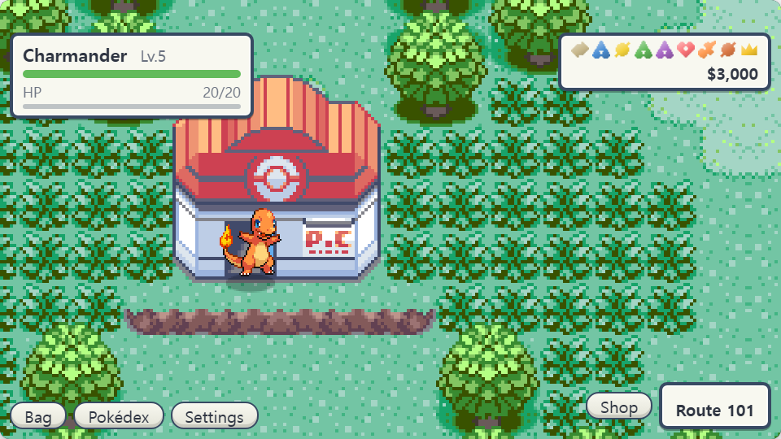 A Pokémon Center</td>
  </tr>
</table>

## Battles

Battles are fought **automatically**. Which moves get used is up to you, in **Auto-battle** under Bag → Pokémon.

<table>
  <tr>
    <td width="50%" align="center">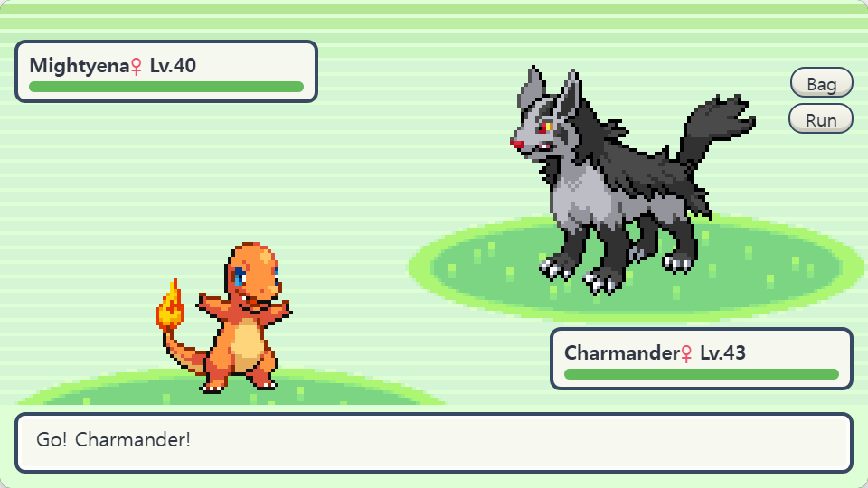 A wild battle</td>
    <td width="50%" align="center">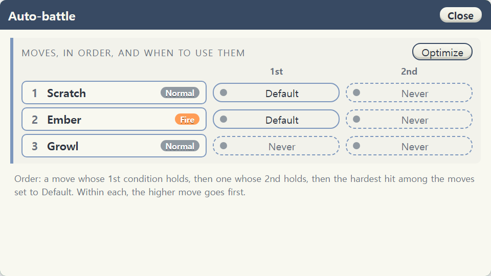 Auto-battle settings</td>
  </tr>
</table>

## Catching

**Win a battle** against a wild Pokémon and it goes up to **To catch** in the top right of the screen. Tap its
icon to open the catch screen and pick a ball from your bag to throw. What you catch goes into your box.

<table>
  <tr>
    <td width="50%" align="center">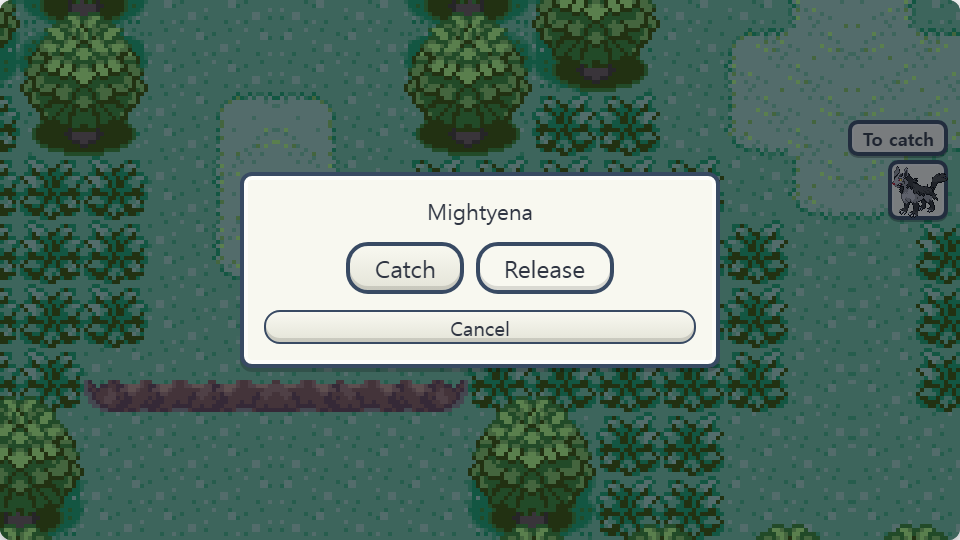 Waiting in To catch</td>
    <td width="50%" align="center">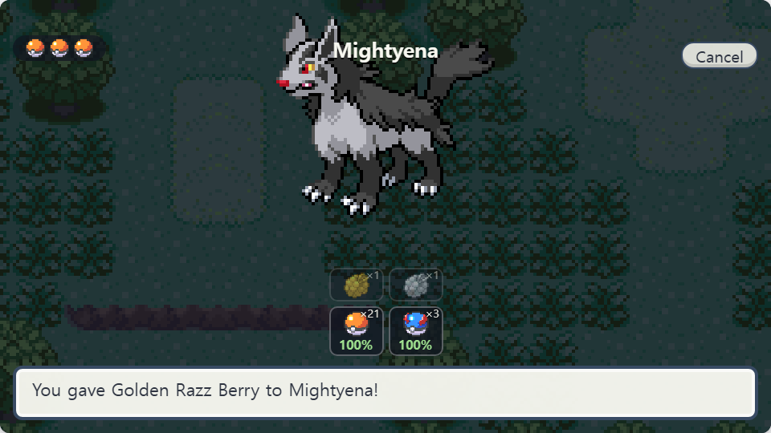 The catch screen</td>
  </tr>
</table>

## Shop

Open it any time with the **Shop** button at the bottom right of the field. You earn money by beating trainers,
and pay out when you lose to them.

## Gyms

Gym Leaders show up in place of trainers as your Pokémon grows, and beating one earns you a **badge**.

<table>
  <tr>
    <td width="50%" align="center">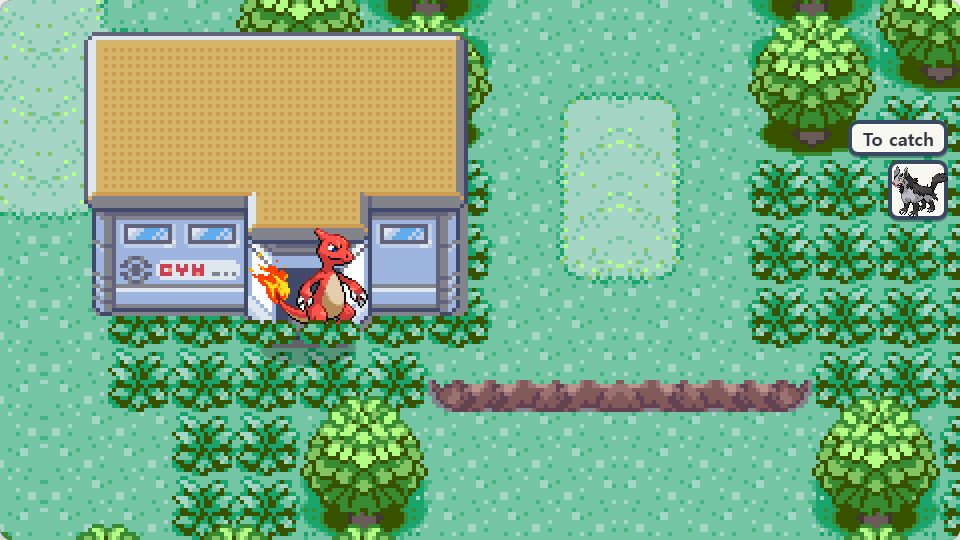 A gym on the road</td>
    <td width="50%" align="center">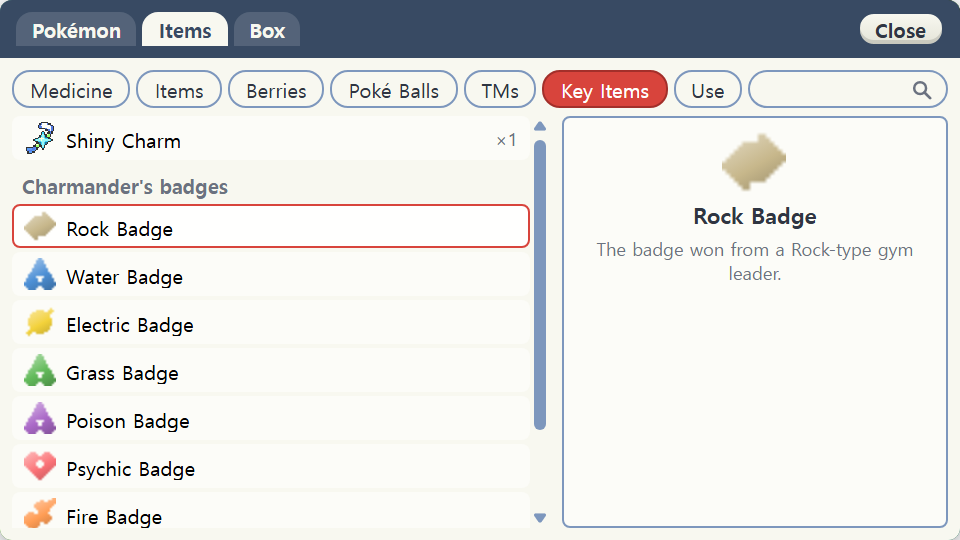 The badge case</td>
  </tr>
</table>

## The Pokémon League

**Once you have 8 badges**, a **Head for the Pokémon League** button appears at the bottom of the field. Beat the Elite Four
and then the Champion in turn to become Champion. If you leave partway with
**Get ready**, you can pick up again from where you won. Badges and the Champion title are kept per Pokémon.

<table>
  <tr>
    <td width="50%" align="center">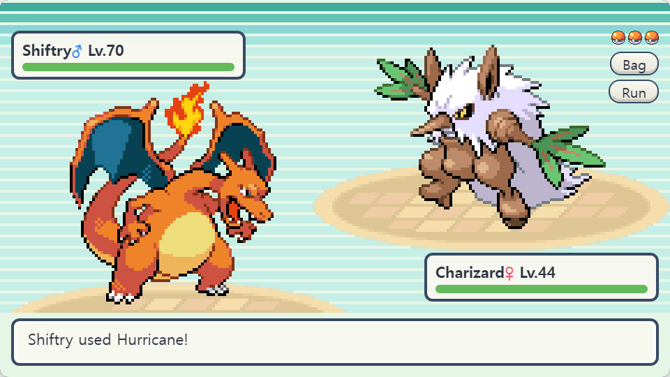 The Elite Four</td>
    <td width="50%" align="center">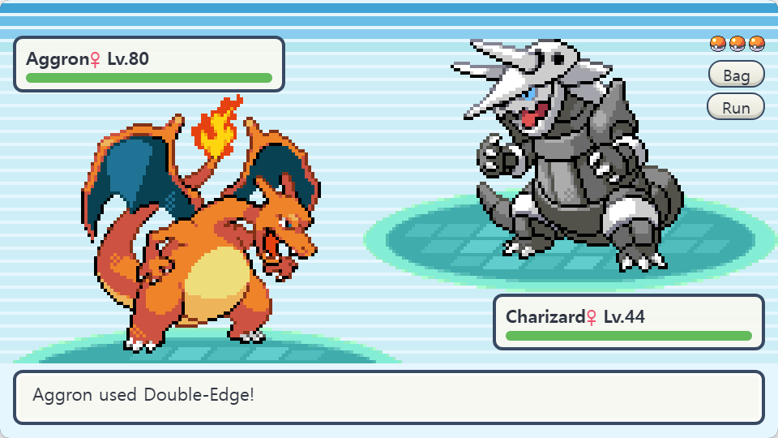 The Champion</td>
  </tr>
</table>

## Bag, Pokédex and box

<table>
  <tr>
    <td width="33%" align="center">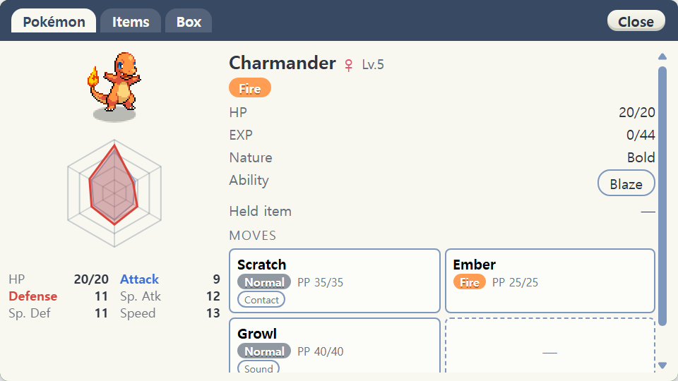 Bag</td>
    <td width="33%" align="center">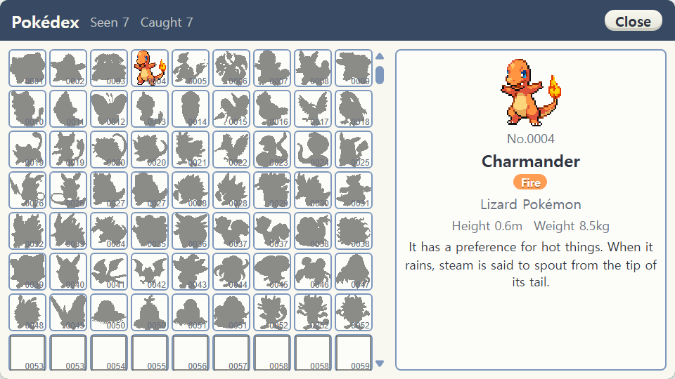 Pokédex</td>
    <td width="33%" align="center">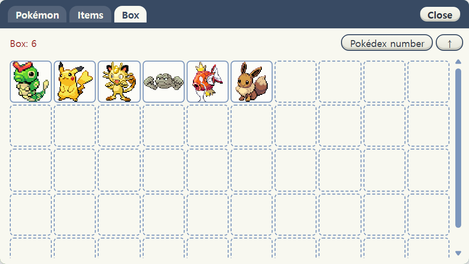 Box</td>
  </tr>
</table>

## Settings

| Tab | What's in it |
| --- | --- |
| Display | Window size |
| Sound | Music · sound effect · cry volume |
| Language | 한국어 / English |
| Credits | The list of sprite artists |

## Credits

| What | Source |
| --- | --- |
| Pokémon data, official names and descriptions in each language | [PokeAPI](https://github.com/PokeAPI/api-data) |
| Pokémon sprites | #1–649: the official Pokémon Black & White sprites · after that, and regional forms: the [Smogon Sprite Project](https://www.smogon.com/forums/threads/sword-shield-sprite-project.3647722/) (artists listed in the game under **Settings → Credits**) · [PokeAPI/sprites](https://github.com/PokeAPI/sprites) |
| Cries | [PokeAPI/cries](https://github.com/PokeAPI/cries) |
| Maps · trainer sprites · item icons · BGM | [pret/pokeemerald](https://github.com/pret/pokeemerald), [pret/pokefirered](https://github.com/pret/pokefirered) |
| Move effects · categories | [Pokémon Showdown](https://github.com/smogon/pokemon-showdown) |
| Official Korean text | [sv-text](https://github.com/Pokemon-Project-com/sv-text), [PokeMiners/pogo_assets](https://github.com/PokeMiners/pogo_assets) |

All rights to Pokémon and its related names, images and music belong to Nintendo / Creatures Inc. /
GAME FREAK inc. This game uses them solely as a non-commercial fan project.
